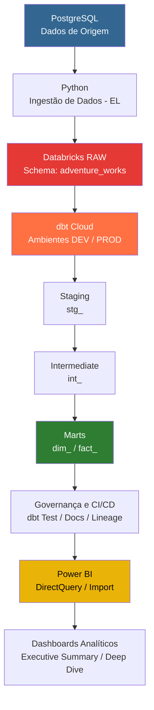

# 🚴 Adventure Works (AW) - Modern Data Platform & Analytics Engineering

[](https://www.getdbt.com/)
[](https://databricks.com/)
[](https://powerbi.microsoft.com/)
[](https://github.com/)

---

## 📌 1. Visão Geral do Projeto

A **Adventure Works (AW)** é uma indústria de bicicletas em expansão, com mais de 500 produtos, 20.000 clientes e 31.000 pedidos.

Este projeto implementa uma **Plataforma Moderna de Dados (Modern Data Stack)** de ponta a ponta, transformando dados brutos em informações estratégicas para apoiar a tomada de decisão baseada em dados (*Data-Driven Decision Making*).

### 🎯 Objetivos Principais

- **Centralização e Governança:** Consolidação dos dados transacionais da empresa no Data Warehouse utilizando Databricks.
- **Transformação Escalável:** Modelagem dimensional em estrela (*Star Schema*) utilizando dbt Cloud.
- **Garantia da Qualidade:** Implementação de testes de integridade referencial, validação de fontes e auditoria contábil.
- **Tomada de Decisão:** Desenvolvimento de dashboards interativos no Power BI, com foco em storytelling executivo e análise tática.

---

## 🏗️ 2. Arquitetura da Solução

A arquitetura foi desenvolvida seguindo os princípios de uma Modern Data Platform, contemplando ingestão, armazenamento, transformação, governança e visualização.

### 🔄 Fluxo de Dados



### 📚 Camadas de Transformação

| Camada | Prefixo | Responsabilidade |
|:---|:---|:---|
| Staging | `stg_` | Limpeza, tipagem e padronização dos dados de origem. |
| Intermediate | `int_` | Aplicação de regras de negócio, junções e transformações intermediárias. |
| Marts | `dim_` / `fact_` | Modelagem dimensional e disponibilização dos dados para análise. |

---

## 🛠️ 3. Tecnologias Utilizadas

| Tecnologia | Aplicação no Projeto |
|:---|:---|
| PostgreSQL | Banco de dados relacional de origem. |
| Python | Script de ingestão e movimentação dos dados. |
| Databricks | Plataforma Lakehouse para armazenamento e processamento. |
| Unity Catalog | Governança e gerenciamento de dados. |
| dbt Cloud | Transformação, modelagem, testes e documentação. |
| SQL / Jinja / YAML | Desenvolvimento dos modelos e configurações dbt. |
| Git / GitHub | Controle de versão e versionamento do projeto. |
| Power BI | Visualização, análise e apresentação dos indicadores. |

---

## 📁 4. Estrutura do Repositório

O projeto está organizado seguindo a estrutura padrão de um projeto **dbt**, com diretórios específicos para modelagem, testes, documentação, macros e análises.

```text
adventure-works/
│
├── analyses/                  # Consultas SQL para análises exploratórias
│
├── docs/                      # Documentação e diagramas do projeto
│
├── macros/                    # Macros personalizadas em Jinja/SQL
│
├── models/                    # Modelos de transformação dbt
│   ├── staging/                # Limpeza e padronização dos dados
│   ├── intermediate/           # Transformações intermediárias
│   └── marts/                  # Fatos e dimensões (Star Schema)
│
├── pbix/                      # Arquivos do Power BI
│
├── seeds/                     # Arquivos CSV para carga via dbt
│                               # Diretório não utilizado no projeto
│
├── snapshots/                 # Controle histórico de alterações
│                               # Diretório não utilizado no projeto
│
├── tests/                     # Testes de qualidade e auditoria dos dados
│
├── .gitignore                 # Arquivos e diretórios ignorados pelo Git
│
├── LICENSE                    # Licença do repositório
│
├── README.md                  # Documentação principal do projeto
│
├── dbt_project.yml            # Configurações principais do projeto dbt
│
├── package-lock.yml           # Arquivo de controle de dependências
│
└── packages.yml               # Configuração dos pacotes do dbt
```

### 📂 Descrição dos Diretórios

| Diretório / Arquivo | Descrição | Utilização |
|:---|:---|:---|
| `analyses/` | Consultas SQL destinadas a análises exploratórias. | Estrutura disponível |
| `docs/` | Documentação técnica e diagramas da solução. | Utilizado |
| `macros/` | Funções reutilizáveis desenvolvidas com Jinja e SQL. | Estrutura disponível |
| `models/` | Camada principal de transformação dos dados no dbt. | Utilizado |
| `pbix/` | Arquivos dos dashboards desenvolvidos no Power BI. | Utilizado |
| `seeds/` | Diretório destinado à ingestão de arquivos CSV pelo dbt. | Não utilizado |
| `snapshots/` | Diretório destinado ao versionamento histórico dos registros. | Não utilizado |
| `tests/` | Testes de qualidade, integridade e auditoria dos dados. | Utilizado |
| `.gitignore` | Define arquivos e diretórios ignorados pelo Git. | Utilizado |
| `LICENSE` | Define os termos de utilização e distribuição do projeto. | Disponível |
| `dbt_project.yml` | Define configurações, caminhos e propriedades do projeto dbt. | Utilizado |
| `packages.yml` | Define as dependências externas do projeto dbt. | Disponível |
| `package-lock.yml` | Arquivo relacionado ao controle de versões das dependências. | Disponível |
| `README.md` | Documentação principal do repositório. | Utilizado |

**Observação:** Os diretórios `seeds/` e `snapshots/` fazem parte da estrutura padrão do dbt, mas não foram utilizados no desenvolvimento desta solução. Sua presença no repositório não significa que existam processos implementados nessas camadas.

## 📐 5. Modelagem Dimensional (Camada Marts)

A modelagem dimensional foi desenvolvida seguindo os princípios de Ralph Kimball, utilizando o modelo **Star Schema (Esquema Estrela)**.

### ⭐ 5.1. Tabela Fato

**`fact_sales`**

Representa as vendas realizadas pela Adventure Works.

- **Granularidade:** Um registro por item do pedido de venda (`pk_sales_order_detail`).

**Principais métricas:**

| Métrica | Descrição |
|:---|:---|
| `gross_sales` | Valor bruto das vendas. |
| `discount_value` | Valor dos descontos. |
| `net_sales` | Valor líquido das vendas. |
| `order_qtd` | Quantidade de itens vendidos. |

### 📊 5.2. Tabelas de Dimensão

| Dimensão | Descrição |
|:---|:---|
| `dim_customers` | Cadastro consolidado de clientes e lojas. |
| `dim_products` | Produtos, subcategorias e categorias. |
| `dim_location` | Cidades, estados e países relacionados aos endereços de cobrança e envio. |
| `dim_calendario` | Dimensão de tempo para análises temporais. |
| `dim_credit_cards` | Informações sobre os tipos de cartões de crédito. |
| `dim_status_orders` | Status e acompanhamento do fluxo dos pedidos. |
| `dim_sales_reasons` | Motivos associados às vendas. |

### 🔗 5.3. Tabela Ponte (Bridge)

**`dim_bridge_sales_order_reasons`**

Responsável por resolver o relacionamento muitos-para-muitos (N:M) entre pedidos e múltiplos motivos de venda.

Essa estrutura permite analisar os motivos associados a cada pedido sem provocar duplicidade ou inflação dos valores financeiros nas métricas da tabela fato.

### 📄 5.4. Diagrama Conceitual

O modelo conceitual completo do Data Warehouse está disponível em:

`docs/diagrama_conceitual_dw.pdf`

---

## 🧪 6. Qualidade dos Dados e Testes (dbt)

A qualidade dos dados é um dos pilares da solução. Foram implementadas três camadas de validação para garantir consistência, confiabilidade e integridade das informações.

### 6.1. Testes de Sources

Validação das tabelas brutas para identificar:

- Valores nulos em campos obrigatórios (`not_null`).
- Registros duplicados em campos únicos (`unique`).

### 6.2. Testes de Primary Keys

Garantia de unicidade e integridade das chaves primárias nas tabelas de fatos e dimensões.

### 6.3. Data Test de Auditoria — Requisito do CEO

Foi desenvolvido um teste customizado para atender à solicitação de auditoria do CEO, Carlos Silveira.

**Objetivo:** Validar se o faturamento bruto registrado no ano de 2011 corresponde exatamente ao valor esperado de:

### 💰 US$ 12.646.112,16

**Arquivo de teste:**

`dbt_project/tests/audit_gross_sales_2011.sql`

### 💻 Comandos de Execução no dbt Cloud

**Executar os modelos:**

```bash
dbt run
```

**Executar testes das fontes:**

```bash
dbt test --select source:*
```

**Executar todos os testes dos modelos e auditoria:**

```bash
dbt test
```

**Gerar documentação e linhagem dos dados:**

```bash
dbt docs generate
```

---

## 📊 7. Painéis de Business Intelligence (Power BI)

O projeto contempla dashboards desenvolvidos no Power BI, organizados em duas abas interativas.

A construção dos painéis utiliza princípios de **Data Storytelling**, com organização visual baseada no padrão F-pattern e posicionamento estratégico dos indicadores (KPIs).

### 📈 7.1. Aba 1 — Visão Geral Executiva (Executive Summary)

Painel direcionado à análise gerencial e ao acompanhamento dos principais indicadores de desempenho da empresa.

### 🔎 7.2. Aba 2 — Detalhamento Multidimensional (Deep Dive)

Painel destinado à exploração analítica dos dados, permitindo aprofundar as análises sob diferentes perspectivas de negócio.

### 📂 Arquivo Power BI

O arquivo completo do projeto está disponível em:

`pbix/adventure_works_analytics.pbix`

🔗 Clique aqui para acessar o Dashboard Interativo no Power BI
---

## 📹 8. Apresentação em Vídeo

A demonstração técnica e visual apresenta os principais componentes da solução:

- Arquitetura e fluxo de ingestão dos dados.
- Orquestração e execução dos modelos no dbt Cloud.
- Execução dos testes de qualidade e auditoria.
- Documentação e linhagem dos dados (*Data Lineage*).
- Navegação e análise dos dashboards no Power BI.

🔗 **[Link para o Vídeo de Demonstração](https://drive.google.com/file/d/10od3CUb_-KpTyTDxiPxt67qcJrZ5-gE6/view?usp=sharing)**

---

## 🚀 9. Resultados e Benefícios

A implementação da plataforma proporciona:

- Centralização dos dados em uma arquitetura Lakehouse.
- Padronização e escalabilidade dos processos de transformação.
- Maior confiabilidade por meio de testes automatizados.
- Governança e rastreabilidade dos dados.
- Modelagem dimensional otimizada para análises de negócio.
- Disponibilização de indicadores estratégicos por meio do Power BI.

---

## 👨‍💻 10. Autor

**Danilo Justino**  
*Data Analytics | Analytics Engineering | Data Engineering*

Projeto desenvolvido com foco na aplicação prática de conceitos de Engenharia de Dados, Analytics Engineering, Modelagem Dimensional, Modern Data Stack e Business Intelligence.

🔗 **GitHub:** [github.com/destudos36-lab](https://github.com/destudos36-lab)

---

⭐ Se este projeto foi útil ou interessante, considere deixar uma estrela neste repositório!
